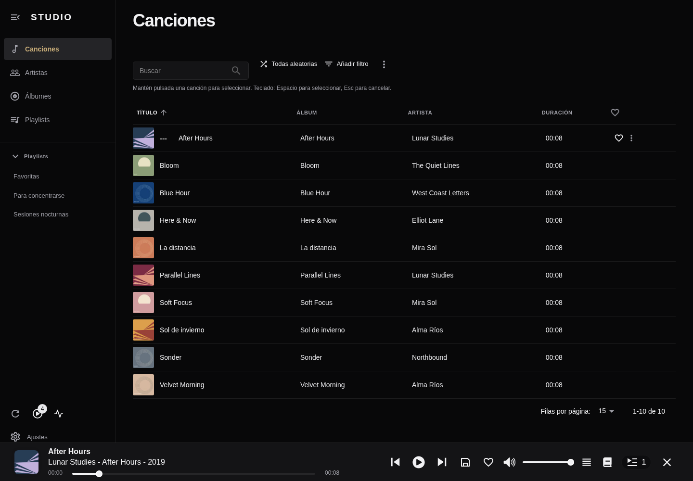

# Studio for Navidrome


Proyecto independiente, sin afiliación ni respaldo del proyecto Navidrome.

Versión no oficial de **Navidrome 0.64.2** con una interfaz oscura y minimalista, inspirada visualmente en Tidal. Canciones es la vista inicial: portadas, títulos y artistas sobre fondo negro, con dorado reservado para textos seleccionados.

La navegación vive en el lateral: **Canciones → Artistas → Álbumes → Playlists**. El engranaje inferior conserva los ajustes personales, administración y cuenta; actualizar, actividad y reproducción actual también están en el lateral. No hay barra superior ni accesos a Radios o Shares. Las playlists, búsqueda, favoritos, cola, descargas y controles del reproductor siguen disponibles.

El reproductor inferior organiza la portada y los datos a la izquierda, los controles y el progreso en el centro, y la cola con el volumen a la derecha. El menú **⋯** conserva favoritos, guardar la cola como playlist, letras, calidad del audio y cerrar el reproductor. **Reproducir todo** respeta la búsqueda, los filtros y el orden elegidos; **Aleatorio** conserva la selección aleatoria de hasta 500 canciones. El lateral se desplaza sin mostrar una barra blanca.

Mantén pulsada una canción durante medio segundo para seleccionarla y toca otras para añadirlas a la selección. Las acciones y el contador aparecen durante la selección; **×** la cancela. Con teclado, **Espacio** selecciona, **Enter** reproduce o alterna la selección y **Esc** cancela. Desplazar o arrastrar cancela la pulsación prolongada. El modo de selección conserva las acciones permitidas por cada lista y sus permisos.



[Ver móvil](docs/studio/screenshots/studio-mobile.png) · [Ver selección táctil](docs/studio/screenshots/studio-selection.png) · [Ver fondo de artista](docs/studio/screenshots/studio-album-background.png)

Las capturas muestran una biblioteca sintética de prueba. Studio conserva el servidor, autenticación, escáner, reproducción y API Subsonic/OpenSubsonic de Navidrome. No incorpora el clasificador de géneros de Playlistr: Playlistr sigue siendo una aplicación independiente que se puede conectar a este servidor.

## Iconos

Icono original negro animado, variantes clara/oscura y archivos estáticos para lanzadores. El logo oficial de Navidrome no se ha modificado.

- [SVG negro animado](https://raw.githubusercontent.com/diegoshock/navidrome-studio/main/ui/public/icons/studio-for-navidrome-animated.svg)
- [SVG negro estático](https://raw.githubusercontent.com/diegoshock/navidrome-studio/main/ui/public/icons/studio-for-navidrome-dark.svg) · [SVG blanco estático](https://raw.githubusercontent.com/diegoshock/navidrome-studio/main/ui/public/icons/studio-for-navidrome-light.svg)
- [Paquete ZIP para Dashboard Icons](https://raw.githubusercontent.com/diegoshock/navidrome-studio/main/docs/studio/icons/studio-for-navidrome-icons.zip)
- [Licencia y guía de envío](docs/studio/icons/README.md). Los iconos originales son Apache-2.0; la aplicación sigue bajo GPLv3.

La aplicación incorpora el icono en el lateral, el inicio de sesión, favicons, iconos de instalación/PWA y el template Unraid. La animación respeta la preferencia de reducir movimiento; los PNG/ICO son estáticos. Los identificadores del repositorio, la imagen Docker y el contenedor no cambian. En un contenedor Unraid ya instalado, pega la URL del [PNG](https://raw.githubusercontent.com/diegoshock/navidrome-studio/main/ui/public/icons/studio-for-navidrome.png) en **Icon URL** si quieres actualizar su icono: actualizar la imagen Docker no reemplaza las plantillas locales.

## Estado y publicación en GHCR

El paquete **linux/amd64** es público y se descarga sin credenciales. La entrega **0.64.2-studio.11** añade Discover, selecciones diarias, accesos a recientes y más reproducidos, favoritos, playlists agrupadas, búsqueda global y una vista Now Playing con portada y cola. **Canciones al azar** usa ahora la misma cola aleatoria amplia que el botón Aleatorio de Canciones, en vez de repetir la pequeña muestra del Home. Toda la navegación de álbumes vive en el lateral principal: la cuadrícula no repite buscador, filtros ni un segundo menú. También corrige el recorte de etiquetas en español y elimina las líneas residuales del encabezado. El reproductor inferior conserva reproducción, progreso, calidad, pantalla completa, cola y volumen. También mantiene scroll automático, selección táctil, PWA e identidad gráfica de Studio. Las actualizaciones se pueden seguir en [Actions](https://github.com/diegoshock/navidrome-studio/actions/workflows/publish.yml). En Unraid, usa **Check for Updates → Update** para descargar la nueva imagen y recarga la interfaz. No necesitas volver a crear el contenedor ni usar Docker Compose.

Cada push a `main` activa el workflow **Test and publish Navidrome Studio**, que prueba el frontend y publica:

```text
ghcr.io/diegoshock/navidrome-studio:latest
```

También crea `sha-<commit>` para fijar una versión. Puedes ejecutarlo manualmente desde **Actions → Test and publish Navidrome Studio → Run workflow**, seleccionando `main`. Usa el `GITHUB_TOKEN` automático; no necesita un PAT adicional. La primera vez, establece el paquete en **Public** desde sus ajustes para descargarlo en Unraid sin iniciar sesión. Una ejecución fallida no genera una nueva imagen.

## Probar en Unraid, sin Docker Compose

Prueba Studio en paralelo, con datos nuevos. No apuntes dos servidores activos a la misma base de datos. La carpeta de música sí se puede compartir en **solo lectura**.

1. Prepara los datos desde la terminal de Unraid:

   ```bash
   mkdir -p /mnt/user/appdata/navidrome-studio
   chown 99:100 /mnt/user/appdata/navidrome-studio
   chmod 700 /mnt/user/appdata/navidrome-studio
   ```

2. En **Docker → Add Container**, configura:

   | Campo | Valor |
   | --- | --- |
   | Name | `navidrome-studio` |
   | Repository | `ghcr.io/diegoshock/navidrome-studio:latest` |
   | Network Type | `bridge` |
   | Puerto TCP | **Contenedor `4533` → host `4534`** |
   | Datos, lectura/escritura | `/mnt/user/appdata/navidrome-studio` → `/data` |
   | Música, solo lectura | Tu carpeta de música → `/music` |
   | `ND_DEFAULTTHEME` | `Studio` |
   | `ND_DEFAULTLANGUAGE` | `es` |
   | `ND_ENABLECOVERANIMATION` | `false` |
   | Extra Parameters | `--user 99:100 --security-opt=no-new-privileges --cap-drop=ALL` |
   | WebUI | `http://[IP]:[PORT:4533]/` |

   Mantén **Privileged** desactivado. Adapta UID/GID si tu servidor usa otros permisos. Si el puerto host `4534` está ocupado, cambia únicamente el puerto **host**.

3. Pulsa **Apply** y abre `http://IP-DE-UNRAID:4534`. Crea el administrador de esta nueva instancia y espera el escaneo.
4. Si aparece el tema anterior, entra en **Ajustes → Personal → Tema → Studio**. Studio y Studio Dark usan ahora la misma apariencia oscura. Las preferencias explícitas de otros temas se conservan.

La [plantilla XML directa](https://raw.githubusercontent.com/diegoshock/navidrome-studio/main/unraid/navidrome-studio.xml) contiene estos campos. Guárdala como `/boot/config/plugins/dockerMan/templates-user/my-navidrome-studio.xml` y selecciónala en **Add Container**. No requiere instalar Docker Compose ni está publicada en Community Applications.

Tus usuarios, favoritos y playlists actuales no aparecen automáticamente en esta instalación de prueba. Esta versión de Studio usa la misma base que **Navidrome 0.64.2**. Para una migración posterior, detén el original y respalda sus datos completos antes de copiar o cambiar su carpeta de datos. Evita abrir una base de datos de una versión más reciente con una versión anterior. Para volver al original durante la prueba, basta con detener Studio y usar el servidor que ya tenías.

Para conectar Playlistr a la instancia de prueba, usa `http://IP-DE-UNRAID:4534` y las credenciales de Studio. Los clientes Subsonic pueden usar esa misma dirección.

## Fondos de artistas

Las cabeceras de álbumes usan la imagen del artista principal del álbum, desenfocada y oscurecida. La vista del artista utiliza su propia imagen y las playlists su portada. Cuando falta una foto, el álbum conserva su portada como fondo.

Se reutiliza el sistema de imágenes de Navidrome: fotos subidas desde la ficha del artista, archivos locales y proveedores de metadatos configurados, como Deezer. Para obtener imágenes desde internet, mantén `ND_ENABLEEXTERNALSERVICES=true` y `ND_DEEZER_ENABLED=true` (valores predeterminados), con `external` en `ND_ARTISTARTPRIORITY`. No hace falta una clave de IA ni OpenRouter. La disponibilidad depende del proveedor y de la identificación del artista; también puedes subir una imagen manualmente desde su ficha. Las imágenes se sirven y almacenan mediante Navidrome, sin añadir un servicio externo al navegador.

## Código y compilación

Este repositorio contiene el código completo de Studio. La base es [Navidrome v0.64.2](https://github.com/navidrome/navidrome/tree/101145742f4762164202cb4858c9126258bdc463), commit `101145742f4762164202cb4858c9126258bdc463`. Se conservan sus licencias y atribuciones. La documentación original está en [UPSTREAM-README.md](docs/studio/UPSTREAM-README.md).

```bash
git clone https://github.com/diegoshock/navidrome-studio.git
cd navidrome-studio
docker build -f Dockerfile.studio -t navidrome-studio:local .
```

El build usa Node 24, Go 1.27 y la imagen de ejecución `deluan/navidrome:0.64.2`. Compila un binario con el frontend incorporado. No basta con montar una carpeta web sobre el contenedor oficial. `Dockerfile.studio` es el Dockerfile de esta distribución; `Dockerfile` conserva el original de upstream.

Para entornos con una CA corporativa, el Dockerfile admite `--secret id=build_ca,src=/ruta/al/bundle.pem`. Mantiene la validación TLS.

Para desarrollar y verificar el frontend:

```bash
cd ui
npm ci
npm run lint
npm run type-check
npm test -- --maxWorkers=2
npm run build
```

El frontend de desarrollo usa el puerto 4533 y espera el backend en 4633. Para iniciarlo con un backend de prueba ya configurado, ejecuta `npm start`. Usa datos aislados durante el desarrollo. Los resultados de las pruebas están en [VALIDATION.md](docs/studio/VALIDATION.md).

Las modificaciones principales están en `ui/src/layout/` (navegación), `ui/src/common/SongDatagrid.jsx` y `useSongSelection.js` (interacción), las vistas de canciones/álbumes/artistas/playlists, `ui/src/studio/` y `ui/src/themes/studio*.js` (presentación). Se mantienen los servicios y API de Navidrome sin cambios de código Go.

## Licencia y mantenimiento

Navidrome y esta modificación se distribuyen bajo **GPLv3**; consulta [LICENSE](LICENSE). Studio es independiente de Navidrome y Tidal y no utiliza la marca ni recursos gráficos de Tidal. La imagen incluye el código correspondiente en `/usr/share/navidrome-studio/source.tar.gz`:

```bash
docker cp navidrome-studio:/usr/share/navidrome-studio/source.tar.gz ./navidrome-studio-source.tar.gz
```

La base está fijada: las actualizaciones de Navidrome no se aplican automáticamente. Para actualizarla hay que integrar los cambios de upstream, revisar las modificaciones de Studio, ejecutar las pruebas y publicar una imagen nueva. Las dependencias y capas de contenedor pueden variar aunque la revisión del código esté fijada; no se garantiza igualdad binaria entre compilaciones.
